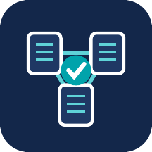
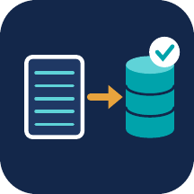

# Hi, I'm Issaka Mohammed

Business Central Developer (AL) | MB-800 & MB-820 Certified | BSc Computer Science, MSc Information Systems

I build on Dynamics 365 Business Central: AL extensions, reporting on Business Central data, and data migration into it. Each of the five projects below was built end-to-end, with architecture decisions, working code, testing or reconciliation, and documentation of real platform behaviors discovered along the way, including problems caught and fixed, not just features that worked on the first try.

## 📦 Projects

### [Warehouse Control](https://github.com/issakamo/business-central-warehouse-control)

Inventory exception detection and warehouse visibility. Automatically
flags stock discrepancies and receiving variances during real posting
processes, prioritizes them by variance severity, and surfaces them
through a Role Center dashboard, Item Card integration, and management
reporting.
**Demonstrates:** event subscribers on standard posting codeunits,
FlowField vs. frozen-snapshot data modeling, Word-layout reports,
permission sets, automated tests.
[Video walkthrough](https://youtu.be/G0yQwuGnR10)

### [Purchase Control](https://github.com/issakamo/business-central-purchase-control)

Purchase order risk detection with full 3-way match validation
(PO ↔ receipt ↔ invoice). Weighted risk scoring, a vendor reliability
scorecard with a minimum-sample-size guard, and administrative-closure
handling so resolved risk clears itself automatically.
**Demonstrates:** multi-document business logic, a staged decision-
table risk model, Business Central platform behaviors found and
documented through manual verification (including a real match-status
masking bug caught by hand-testing in the Web Client, not by an
automated test).
[Video walkthrough](https://youtu.be/cMcnb_IZdMk)

### [FX Integration](https://github.com/issakamo/business-central-fx-integration)

Automated foreign exchange rate sync from a live external API
([Frankfurter](https://frankfurter.dev)) into Business Central's native
currency data, plus a read-only outbound OData v4 API.
**Demonstrates:** AL `interface` types for a swappable, testable
connector (mock vs. live HTTP), `HttpClient`/JSON parsing, retry and
audit logging, and a safety guard against writing incorrect financial
master data.
[Video walkthrough](https://youtu.be/ecQFkwDQ8xM)

### [Finance Analytics](https://github.com/issakamo/business-central-finance-analytics)

A Power BI finance report built on Business Central data: sales and
margin, budget vs. actual, receivables aging, and working capital
(DSO, DPO, DIO, cash conversion cycle). Twelve read-only AL API queries
feed a star-schema model, deployed as a per-tenant extension to a
Business Central online sandbox and reached through service-to-service
OAuth. Every figure was reconciled against Business Central's own reports.
**Demonstrates:** AL API queries, least-privilege permission sets,
Entra app registration, Power BI data modeling and DAX, row-level
security, and data findings documented from real ledger entries.
[Video walkthrough](https://youtu.be/KChtyXQfgjk)

### [QuickBooks Migration](https://github.com/issakamo/business-central-quickbooks-migration)

A complete QuickBooks Online to Business Central migration for a
fictional distributor, rehearsed in two trial runs (a local BC 28.3
container, then a BC 29.0 online sandbox) and reconciled to the cent:
all 54 accounts with a balance match the source, and the opening
balance clearing account ends at $0.00.
**Demonstrates:** data profiling and an issues log, account and
master-data mapping, RapidStart packages built by Python scripts,
opening balances through subledgers (AR, AP, FIFO stock, bank),
NC/SC sales tax setup, 1099 tracking across a mid-year cutover, and a
cutover checklist with go/no-go criteria.
[Video walkthrough](https://youtu.be/4nT_AlCPxe8)

## 🛠️ Technical Focus

`AL` · `Dynamics 365 Business Central` · Event-driven extension design
· `HttpClient` / JSON / REST & OData v4 · API queries and OAuth
(service-to-service) · Automated testing (AL Test Framework) ·
Word-based reporting · `Power BI` / DAX · Data migration with
RapidStart and `Python` · Docker and online sandboxes for BC development

## 📄 Certifications

- MB-800: Microsoft Dynamics 365 Business Central Functional Consultant
- MB-820: Microsoft Dynamics 365 Business Central Developer

## 📫 Let's Connect

[LinkedIn](https://linkedin.com/in/issakamo)
Open to Business Central Developer / Technical Consultant roles in the US/Canada.
